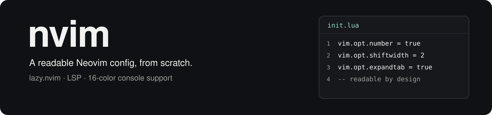

# nvim

<div align="center">

<picture>
  <source media="(prefers-color-scheme: dark)" srcset="docs/assets/banner-dark.svg">
  <source media="(prefers-color-scheme: light)" srcset="docs/assets/banner-light.svg">
  
</picture>

[](LICENSE)
[](#install)
[](lua/config/lazy.lua)

**[Install](#install)** · **[Features](#whats-in-it)** · **[Keymaps](#everyday-keymaps)** · **[TTY support](#the-raw-console-tty-path)**

</div>

A from-scratch Neovim config — built on [lazy.nvim](https://github.com/folke/lazy.nvim)
purely as a plugin manager, not a prebuilt distro (no LazyVim/NvChad/etc.). Every plugin,
keymap, and LSP setting here is something you can read top to bottom and understand, in the
spirit of [kickstart.nvim](https://github.com/nvim-lua/kickstart.nvim).

## What's in it

- **LSP + auto-format + lint**, via Mason, for HTML/CSS/Tailwind/Astro, JS/TS/React/Next,
  Python, Bash, JSON/YAML, Markdown/MDX, Lua, and Rust
- **[blink.cmp](https://github.com/saghen/blink.cmp)** completion, **Treesitter**,
  **Telescope** fuzzy-finder, **neo-tree** file explorer, **bufferline** tabs
- **Git**: gitsigns, diffview, LazyGit (via a floating terminal)
- **Debugging**: full `nvim-dap` + dap-ui setup (Python via debugpy, JS/TS via Mason's
  prebuilt `js-debug-adapter`)
- **Trouble** (Problems panel), **Aerial** (symbols outline), **toggleterm**, **noice**/
  **notify**, a dashboard, session persistence, a color picker + inline color highlighting
- **Five switchable themes**: Catppuccin, One Dark, Kanagawa, Bamboo, Gruvbox — pick with
  `<leader>uc` or set `vim.g.colorscheme` in `lua/plugins/colorscheme.lua`

## The raw-console (TTY) path

This config is primarily used directly on the Linux kernel console (no GUI terminal, no X)
through tmux — a setting where true 24-bit color is architecturally impossible, not just
unconfigured (see [thekusaldarshana/tty-theme](https://github.com/thekusaldarshana/tty-theme)
for the full explanation and the standalone console-theming tool this depends on).

`lua/plugins/tty-theme.lua` detects this (`$XDG_SESSION_TYPE == "tty"`, which survives
through tmux unlike `$TERM`) and swaps the five truecolor plugins above for
[`mini.base16`](https://github.com/echasnovski/mini.nvim) — a 16-color-terminal-correct
rendition of the same five themes, pinned to the exact ANSI indices that `tty-theme` retints.
Switch themes on the console with `tty-theme <name>` in the shell rather than `<leader>uc`.

## Structure

```text
init.lua              entry point
lua/config/            core settings (options, keymaps, autocmds, lazy.nvim bootstrap)
lua/plugins/            one file per plugin/concern — add or remove things by editing one file
```

## Install

If you already have a Neovim configuration, back it up before cloning. This is a
complete config, so compare your existing files before merging. These commands
use the standard Linux/macOS configuration path; other platforms should use the
directory returned by `:echo stdpath('config')`.


```sh
git clone https://github.com/thekusaldarshana/nvim ~/.config/nvim
nvim   # plugins install automatically on first launch
```

Requires Neovim 0.11+ (nvim-treesitter's current branch needs it), `git`, a C compiler,
`ripgrep`, `fd`, and [`tree-sitter-cli`](https://github.com/tree-sitter/tree-sitter) 0.26.1+
(install the CLI from its GitHub releases, not npm).

On first launch, lazy.nvim clones the plugins in `lazy-lock.json`. Mason manages
language tools declared in the plugin configuration. Installation needs network
access, and some language servers, formatters, and debuggers need their own
runtimes. A Nerd Font is recommended for the configured icons.

## Everyday keymaps

The leader key is <kbd>Space</kbd>. These mappings come from
[`lua/config/keymaps.lua`](lua/config/keymaps.lua) and
[`lua/config/lazy.lua`](lua/config/lazy.lua).

| Keys | Action |
| --- | --- |
| `<leader>w` / `<leader>q` | Save / quit the current window |
| `Ctrl-h`, `Ctrl-j`, `Ctrl-k`, `Ctrl-l` | Move between windows |
| `Shift-h` / `Shift-l` | Previous / next buffer |
| `<leader>bd` | Delete the current buffer |
| `<leader>e` | Show diagnostics for the current position |
| `<leader>uc` | Preview and select a colourscheme outside console mode |

Plugin-specific mappings live beside their plugin specs in `lua/plugins/`.
To customise the setup, start with
[`options.lua`](lua/config/options.lua),
[`keymaps.lua`](lua/config/keymaps.lua), and
[`colorscheme.lua`](lua/plugins/colorscheme.lua).

## Troubleshooting

| Symptom | What to check |
| --- | --- |
| Plugins do not install | Check Git/network access and open `:Lazy` for the failing plugin. |
| A parser cannot compile | Check your C compiler and the required tree-sitter CLI. |
| A language tool is missing | Open `:Mason` and inspect its installation status. |
| Clipboard integration does not work | Install an appropriate clipboard provider, such as `xclip` on X11 or `wl-clipboard` on Wayland. |
| Console colours do not match | Check `XDG_SESSION_TYPE=tty` and the companion `tty-theme` palette. Restart Neovim after changing the palette. |

Run `:checkhealth` inside Neovim for the installed tools' diagnostics.

## License

[MIT](LICENSE).
